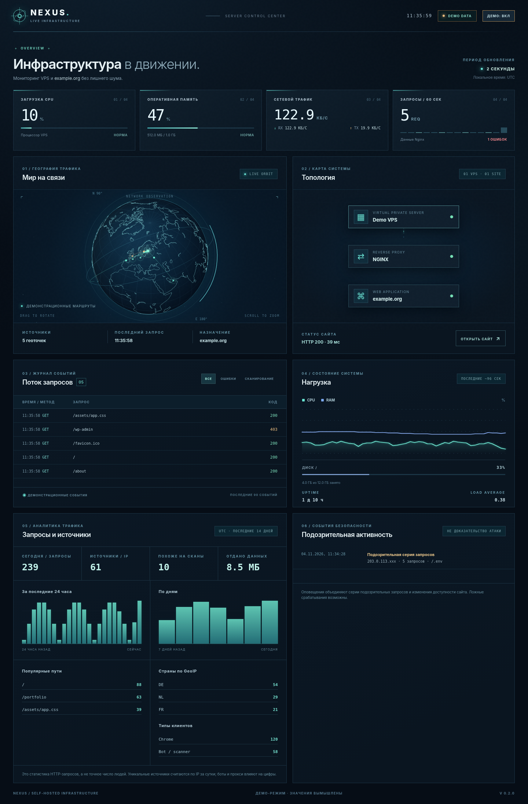

<div align="center">

# NEXUS

### Live infrastructure monitoring for your Linux VPS

*A lightweight, self-hosted dashboard for Nginx traffic, server health, security signals, and geographic request activity.*

**Zero npm dependencies · Real-time SSE · Local GeoIP · Optional Telegram alerts**

  

[English](README.md) · [Русский](README.ru.md)

</div>



*Screenshot shows synthetic demo data. No real server or visitor information is included.*

> [!IMPORTANT]
> NEXUS visualizes **HTTP access-log events**, not packet traces. Security detection is heuristic: suspicious requests do not, on their own, establish an intrusion. The globe uses approximate GeoIP locations when an optional local database is configured.

## Highlights

| Overview | Traffic analytics | Security & privacy |
|---|---|---|
| Live CPU, RAM, disk, network, and uptime | HTTP status codes, top paths, hourly/daily traffic | Scanner-path heuristics and incident grouping |
| Nginx and website availability checks | Approximate distinct IP sources per UTC day | Telegram alerts with cooldowns |
| Canvas-based interactive globe and infrastructure topology | Client categories, referrer hosts, response sizes | Masked IPs in the browser and hashed source IDs at rest |
| Server-Sent Events; automatic reconnection | 14 days of aggregated local history | HTTPS + reverse proxy authentication required |

The application reads an **existing Nginx access log** and samples Linux metrics locally. It does not require cloud telemetry, remote IP lookups, a database service, or frontend build tooling.

## Requirements

- Linux VPS (tested with Ubuntu 22.04/24.04 patterns)
- Node.js 20 or later
- Nginx with an access log in `combined` format
- A reverse proxy with **HTTPS and authentication** for internet-facing use
- Optional: `mmdb-bin` (Ubuntu/Debian) and a locally downloaded City `.mmdb` GeoIP database

## Quick start

```bash
cp .env.example .env
# Edit SITE_URL, SITE_LABEL, NGINX_ACCESS_LOG, and VPS_LABEL.
node server/index.mjs
```

Visit `http://127.0.0.1:4317` locally. The service binds to localhost intentionally; do not expose port `4317` directly to the internet.

For UI exploration without Linux metrics or logs, use the explicitly marked **DEMO** mode.

```bash
npm test
```

## Configuration

Set the following keys in `.env`:

| Key | Purpose | Default |
|---|---|---|
| `PORT` | Local HTTP port | `4317` |
| `VPS_LABEL` | VPS display name | `My VPS` |
| `SITE_LABEL` | Website label | `example.org` |
| `SITE_URL` | Website health-check URL | `https://example.org/` |
| `NGINX_ACCESS_LOG` | Readable, dedicated site access log | `/var/log/nginx/example.access.log` |
| `GEOIP_MMDB` | Optional local GeoLite2 City `.mmdb` | off |
| `SERVER_LAT`, `SERVER_LON` | Coordinates of the **server's datacenter** | off |
| `TELEGRAM_BOT_TOKEN` | Optional Telegram bot token | off |
| `TELEGRAM_CHAT_IDS` | One or more comma-separated chat IDs | off |
| `ALERT_SCAN_THRESHOLD` | Scan-path requests per source within 2 minutes before alert | `3` |

The `.env`, analytics database, IP hashing key, and `.mmdb` databases are git-ignored. **Never commit your bot token, private logs, or a live configuration file.**

## Nginx integration

Use a *dedicated* access log in the HTTPS `server {}` serving your site:

```nginx
access_log /var/log/nginx/example.access.log combined;
```

Ensure the NEXUS service account can **read** this log, without write permissions. Validate configuration changes with `nginx -t` before reloading.

NEXUS supports ordinary `combined` lines, and optionally a trailing `rt=<request_time>` token for response duration. To log duration, define a format at Nginx's **http** level (for example, in `conf.d/nexus-log-format.conf`):

```nginx
log_format nexus_timed '$remote_addr - $remote_user [$time_local] '
                       '"$request" $status $body_bytes_sent '
                       '"$http_referer" "$http_user_agent" rt=$request_time';
```

Then change the *dedicated* site log to:

```nginx
access_log /var/log/nginx/example.access.log nexus_timed;
```

NEXUS logs only processed HTTP requests. Requests blocked upstream by a CDN, requests to other virtual hosts, and unsuccessful TCP connections are outside its scope.

## Telegram alerts

1. Create a bot with Telegram's `@BotFather` and start a private chat with it.
2. Obtain the chat ID, for example by messaging your bot and inspecting `https://api.telegram.org/bot<TOKEN>/getUpdates` locally. Keep the token private.
3. Put `TELEGRAM_BOT_TOKEN` and `TELEGRAM_CHAT_IDS` into `.env`, then restart NEXUS.

By default, an alert is sent only after **3 suspicious HTTP paths from the same source within 2 minutes**. Per-source cooldown is 15 minutes; global cooldown is 1 minute. Set `ALERT_SCAN_THRESHOLD=1` if you need alerts for individual probing attempts, at the cost of more notifications. Site-down alerts require 2 consecutive failed health checks, followed by a recovery notification. Notifications contain **masked** source addresses and sanitized paths.

Telegram is used only when explicitly configured. Messages travel to Telegram servers; leave alerts disabled if that is unsuitable for your privacy requirements.

## GeoIP (optional)

Geolocation is local and **opt-in**. NEXUS never sends visitor IPs to an online geolocation API. Two compatible City MMDB options are:

- [DB-IP City Lite](https://db-ip.com/db/lite.php): free download, usually no account required; **CC BY 4.0 attribution is mandatory** on pages displaying its results. NEXUS automatically displays a DB-IP attribution link when `GEOIP_MMDB` has `dbip` in its filename. If you rename the file, add the attribution link yourself.
- [MaxMind GeoLite2 City](https://dev.maxmind.com/geoip/geolite2-free-geolocation-data): free with approved account access; separate provider terms apply.

On Ubuntu/Debian, install the lookup tool:

```bash
sudo apt update
sudo apt install -y mmdb-bin
```

Download the database from your chosen provider, store it **outside Git** (for example `data/dbip-city-lite-YYYY-MM.mmdb`), and set the full path:

```ini
GEOIP_MMDB=/opt/nexus/data/dbip-city-lite-YYYY-MM.mmdb
SERVER_LAT=60.1700
SERVER_LON=24.9400
```

The coordinates above are **an illustrative datacenter location**, not a claimed location of your server. Replace them with the approximate coordinates of your actual datacenter, never a personal address. Verify the database using `mmdblookup --file /path/to/city.mmdb --ip 8.8.8.8 location latitude`, then restart NEXUS.

NEXUS can show location information for *newly processed* public IP requests. GeoIP is approximate, especially for VPNs, mobile networks, CDNs, and NAT; it cannot identify individuals. Update the database according to its provider's schedule and licensing rules.

## Data retention and safety

- Recent browser events: last **90 sanitized HTTP requests**, retained in process memory.
- Aggregated analytics: last **14 UTC days** in a private local JSON file under `data/`.
- Distinct source counts: derived from daily salted HMAC IP fingerprints, **not human visitor counts**.
- Full source IPs: used temporarily in memory for grouping scans and performing local GeoIP lookup, but **not sent to the frontend or stored in the analytics JSON**.
- URLs: query strings and likely token-like path segments are removed before display/storage.
- API: intentionally lacks authentication of its own. Put a separate HTTPS-authenticated reverse proxy in front; **never bind the app to a public interface**.
- This is an observability dashboard, **not** an intrusion-prevention system, WAF, or forensic log archive. Retain raw Nginx logs separately if investigations are needed.

## Architecture

```text
Browser (Canvas globe, topology, analytics)
     │ SSE /api/stream
     ▼
Nginx reverse proxy (TLS + authentication)
     │ localhost only
     ▼
NEXUS Node.js service (127.0.0.1:4317)
     ├── Linux metrics (/proc, os, statfs)
     ├── Website + service health checks
     ├── Nginx combined access-log tail
     │      ├── Sanitized live events
     │      ├── Local 14-day analytics (JSON)
     │      ├── Scan burst heuristics → optional Telegram
     │      └── Optional local MMDB → globe arcs + countries
     └── SSE clients
```

## Deployment notes

Templates for systemd, Nginx, and log rotation live in [`deploy/`](deploy/). Replace placeholder users, directories, hostnames, and certificates in the example files before use. Prefer a dedicated unprivileged service account and read-only access to your site's access log.

When updating an existing installation, **retain `.env`, `data/`, your systemd unit, and the live Nginx configuration**. Copy the new `client/` and `server/` trees, run tests, then restart the service.

## Development

```bash
npm test
npm start
```

The backend uses Node.js built-ins only. The globe uses Canvas 2D with an orthographic projection rather than a WebGL framework. UI assets are served directly; there is no bundling step.

Changes and bug reports are welcome; see [CONTRIBUTING.md](CONTRIBUTING.md). For vulnerabilities, follow [SECURITY.md](SECURITY.md) rather than opening a public issue with exploit details. See [CHANGELOG.md](CHANGELOG.md) for releases.

## License

[MIT](LICENSE). The application is MIT-licensed; external GeoIP databases have separate licenses. DB-IP Lite requires a visible link back to DB-IP where its results are used. Map geometry has its own data provenance and should be reviewed when redistributing derived datasets.
