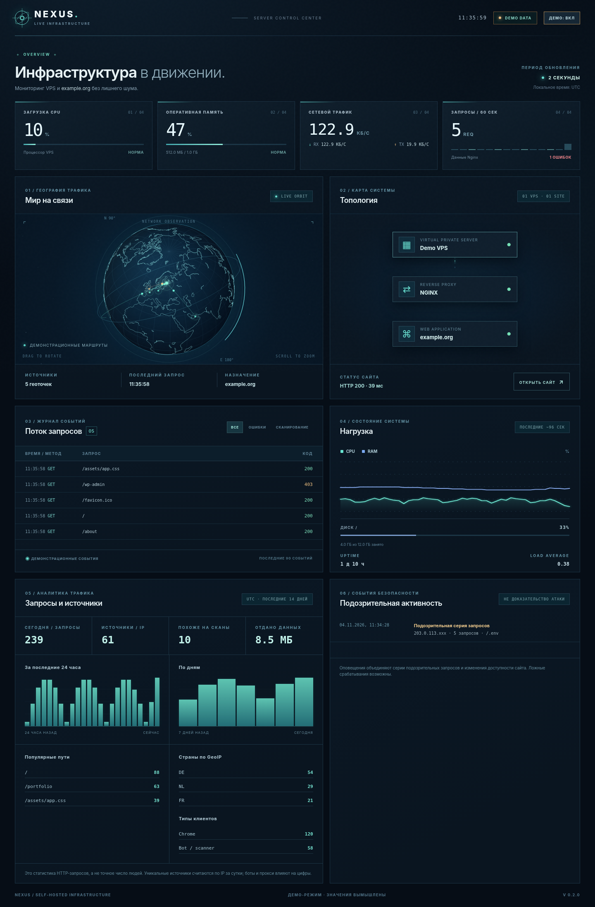

# NEXUS — мониторинг собственного VPS

[English](README.md) · **Русский**

**NEXUS** — лёгкая self-hosted панель для Linux VPS и сайта на Nginx. В реальном времени показывает нагрузку сервера, HTTP-запросы, приблизительную географию источников, подозрительные серии запросов и статистику посещений. Можно подключить Telegram-уведомления.



> Скриншот содержит только вымышленные демонстрационные данные. NEXUS не заменяет WAF, firewall или систему расследования инцидентов.

## Возможности

- CPU, RAM, диск, входящий/исходящий сетевой трафик, uptime.
- Проверка статуса Nginx и доступности сайта.
- Интерактивный глобус и топология VPS → Nginx → сайт.
- Журнал HTTP-запросов со статусами, типами клиентов и маскированными IP.
- Графики за 24 часа и 7 дней, история агрегированных событий за 14 дней.
- Эвристическое обнаружение сканирования `.env`, `wp-admin`, `.git` и других путей.
- Уведомления в Telegram о подозрительных сериях, недоступности сайта и восстановлении.
- Локальная GeoIP-база MMDB (не отправляет IP в сторонние API).

## Требования и запуск

Нужны Linux, Node.js 20+, Nginx и отдельный access log в формате `combined`.

```bash
cp .env.example .env
# Укажи SITE_URL, SITE_LABEL, VPS_LABEL и NGINX_ACCESS_LOG
npm test
node server/index.mjs
```

Веб-интерфейс слушает **только `127.0.0.1:4317`**. Если публикуешь в интернете, используй Nginx с HTTPS и Basic Auth (пример в `deploy/`). **Не открывай порт 4317 наружу.**

## Nginx

В HTTPS-блоке обслуживаемого сайта создай отдельный лог:

```nginx
access_log /var/log/nginx/example.access.log combined;
```

Пользователь, от имени которого запущен NEXUS, должен иметь право **читать**, но не изменять лог. Затем проверь `sudo nginx -t` перед перезагрузкой.

### Ротация логов (v0.2.2)

NEXUS отслеживает активный лог по `device + inode`, дочитывает оставшиеся строки из старого файла при переименовании и подхватывает новый файл после ротации. Временное отсутствие файла и `copytruncate` также обрабатываются. История пропускается только при **первом запуске** программы, но не после ротации.

**Важно:** NEXUS не управляет записью Nginx. Если `access.log` пустой, а `access.log.1` растёт, Nginx всё ещё пишет в переименованный файл. Исправь `postrotate` в своей конфигурации `logrotate` — пример в [`deploy/nexus-logrotate.conf`](deploy/nexus-logrotate.conf):

```text
postrotate
    /usr/sbin/nginx -t
    /bin/systemctl reload nginx
endscript
```

Не используй `|| true`, скрывающее ошибки. **Не копируй пример целиком поверх действующего `/etc/logrotate.d/...`**: в нём демонстрационные пути и владельцы. Для проверки без выполнения ротации: `sudo logrotate -d /etc/logrotate.d/ИМЯ_ФАЙЛА`. Отдельно проверь, что тестовый HTTP-запрос появился в активном логе. `logReadable: true` сообщает лишь о доступности файла, но не гарантирует появление новых строк.

## Telegram

Создай бота через `@BotFather`, начни с ним чат и добавь в локальный `.env`:

```ini
TELEGRAM_BOT_TOKEN=
TELEGRAM_CHAT_IDS=
ALERT_SCAN_THRESHOLD=3
```

По умолчанию уведомление о сканировании приходит после трёх подозрительных запросов с одного источника за две минуты. Также распознаются распределённые серии от 15 подозрительных запросов с трёх и более IP за одну минуту. URL-кодированные пути (`%2eenv`, `%252eenv`) учитываются при обнаружении. Есть ограничение частоты уведомлений. `.env` никогда не загружай на GitHub.

## GeoIP

Можно использовать [DB-IP City Lite](https://db-ip.com/db/lite.php) или [MaxMind GeoLite2 City](https://dev.maxmind.com/geoip/geolite2-free-geolocation-data). Для Ubuntu утилита называется **`mmdb-bin`**:

```bash
sudo apt update && sudo apt install -y mmdb-bin
```

Скачай City-базу формата `.mmdb`, помести в папку `data/` (она исключена из Git), пропиши путь в `.env`:

```ini
GEOIP_MMDB=/opt/nexus/data/dbip-city-lite-YYYY-MM.mmdb
SERVER_LAT=
SERVER_LON=
```

Широта/долгота — **координаты дата-центра**, а не личный адрес. Дуги на глобусе появятся после указания координат назначения и поступления новых геолокируемых запросов.

**Важно:** DB-IP Lite распространяется по CC BY 4.0 и требует указания источника на страницах с геоданными. Для MMDB с `dbip` в имени NEXUS автоматически выводит ссылку «IP Geolocation by DB-IP». Если переименовываешь файл — обеспечь указание источника самостоятельно.

## Конфиденциальность

В интерфейсе IP маскируются. Для приблизительного количества источников используются HMAC-отпечатки по дням. История хранится локально до 14 дней. Данные HTTP-запросов не равны числу людей: роботы и прокси могут искажать статистику. Использование доступа к журналам может требовать соблюдения местных требований к обработке данных.

Подробное описание архитектуры, конфигурации и разработки есть в [основном README](README.md). История релизов — [CHANGELOG.md](CHANGELOG.md), правила сообщения об уязвимостях — [SECURITY.md](SECURITY.md).

Лицензия приложения — [MIT](LICENSE); лицензии сторонних данных применяются отдельно.
